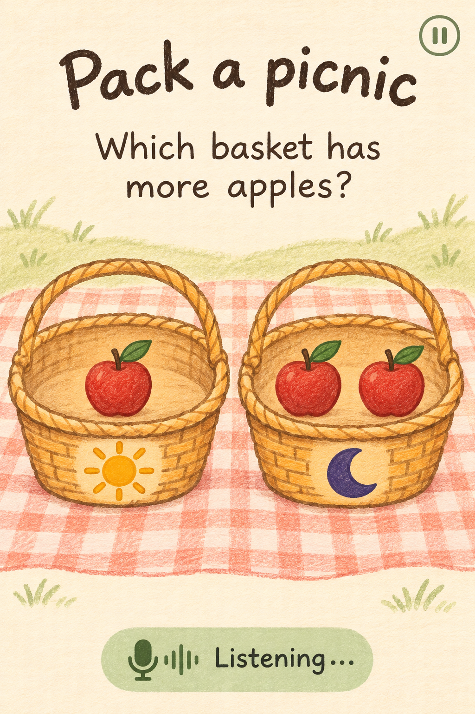

# EXP-02 — Pack a Picnic

**Version:** picnic-comparison-v1 · **Date:** 2026-11-03 · **Status:** fully authored design; not implemented or playtested.

## Purpose and learning contract

**Child goal:** choose supplies for a pretend picnic. Correctly selected supplies move to the blanket; supported or modeled completion can also finish the activity without a failure screen. The child can choose an optional blanket design.

**Primary skill:** NUM-02. The core tests **more**; optional introduced opportunities cover **fewer** and **same** separately. **Suggested entry:** ages 3–6. **Readiness:** understands the item names and can refer to the two baskets. Fluent counting is not required; object matching is an available teaching representation.

**Research connection:** a narrow quantity-comparison opportunity related to P-MATH 4. [Head Start research note](../research/01-head-start-framework.md).

**Hypothesis:** comparison can be taught through visible matching and a meaningful choice, while fresh trials reveal whether the child can compare without that scaffold. **Duration hypothesis:** 3–5 minutes. **Pedagogical stages:** familiarization, optional demonstration, supported recognition, fresh selection, optional relation extension, later retrieval.

## Scene rules

### First visual concept

Generated on 2026-11-03 using the built-in image-generation tool. This static concept explores warm paper, crayon texture, clear basket markers, and a sparse portrait layout for scene P1. The three apples are visibly separated and the baskets have comparable size. Phone-scale usability still needs testing.

This is a composed visual reference, not a production asset set or functioning interface. Production should render the backdrop, baskets, apples, markers, text, and controls separately so quantities and states remain application-controlled. The printed question represents the spoken prompt; child gameplay does not require reading.

[Generation prompt](../assets/concepts/pack-a-picnic-v1.prompt.txt).

### Representation constraints

Two equal-sized baskets have a **sun marker** and a **moon marker**. Introduce their labels without quantity language: “This is the sun basket; this is the moon basket.” Check the child can identify one. If the labels are unfamiliar, teach them or use an agreed neutral alternative before recording comparison evidence.

Within each comparison, objects are the same kind and size. Neither basket has a numeral or a decorative duplicate. The child need not read, say left/right, drag, or touch. Rotate the location of sun and moon baskets between authored scenes while preserving their labels.

## Authored sequence

| ID / role | Visible groups | Example task | Target | Evidence and next action |
| --- | --- | --- | --- | --- |
| P0 / familiarization | Empty sun and moon baskets | “Which is the moon basket?” | Moon marker | Access check only; not comparison evidence |
| P1 / entry | Sun: 1 apple; Moon: 2 apples, equal spacing | “Which basket has more apples: sun or moon?” | Moon | Initial independent opportunity if “more” is understood |
| PD / conditional model | Sun: 2 cups; Moon: 3 cups | “Let's match one cup here with one cup there. The moon basket has one left over. It has more.” | No evaluated response | Pair objects visually; explicitly demonstrate the relation |
| P2 / fresh opportunity | Sun: 3 pears; Moon: 1 pear | “Which basket has more pears: sun or moon?” | Sun | Independent selection if no substantive cue; pack pears after success |
| P3 / layout transfer | Sun: 2 oranges spread apart; Moon: 3 oranges closer together, still distinct | “Which basket has more oranges: sun or moon?” | Moon | Observe resistance to spacing cue; tag changed representation, not identical difficulty |
| PF / optional introduced relation | Sun: 1 napkin; Moon: 2 napkins | “Fewer means a smaller number. Which basket has fewer napkins?” | Sun | Introductory fewer task; record relation teaching, not mastery |
| PS / optional introduced relation | Sun: 3 plates; Moon: 3 plates, in different layouts | “Same number means neither has more. Do these baskets have the same number of plates?” | Yes / same | Introductory equality opportunity; yes/no alone is weak evidence |
| PE / ending | Picnic blanket with selected supplies | “Our picnic is ready. Would you like a striped or dotted blanket?” | Either | Preference, then natural ending |

**Branching:** use PD after uncertainty about “more,” an interpretable error, or a help request. Otherwise keep it available as support. End after P3 by default. Offer one of PF/PS only if the child asks for more play and has two fresh independent core responses. The optional relation is a new objective facet, not simply a higher level of the same task. Do not require it to finish the picnic.

## Response contract

- For a basket-choice task, accept “sun,” “moon,” or an unambiguous phrase selecting that marked basket.
- Accept “the one with three” only if exactly one visible basket matches that quantity and the authored contract can resolve the reference. Record the reference without inferring the child's strategy.
- “That one,” “bigger,” or “yes” is ambiguous for a basket-choice task. Clarify using the basket labels; never guess from a pointing gesture the system cannot observe.
- For the equality question, accept “same,” “yes,” or a clear equivalent. Counterexample trials below are needed to investigate automatic yes-saying.
- Speech uncertainty, unfamiliar relation words, and interpretable wrong selections remain separate.

## Support and environmental feedback

Offer thinking time and one neutral prompt replay. For a clear mismatch, allow a fresh look before teaching. Then move the two groups into matched rows, pairing objects one-to-one. The unmatched objects expose the difference without a spoken verdict. The child can inspect and repair the choice.

Pairing is substantive support. The app must record that it was actually shown and cannot label the subsequent answer independent. For equality, every object gets a partner. If another attempt remains unsuccessful, model the relation and allow completion or a different activity.

Allow at most two response opportunities after the initial attempt. No endless retries. Stop, help, or an early ending remains available. The app controls pairing and movement through authored states; conversational praise alone cannot move supplies or advance the challenge.

## Fresh and delayed item bank

| ID | Use | Exact groups and question | Target |
| --- | --- | --- | --- |
| PTM | Fresh after support on more | Sun: 2 identical bottles; Moon: 1 bottle; “Which has more bottles?” | Sun |
| PTF | Fresh after PF | Sun: 3 identical spoons; Moon: 2 spoons; “Which has fewer spoons?” | Moon |
| PTS | Fresh equality check | Sun: 2 identical cups; Moon: 2 cups; “Same number?” | Yes / same |
| PTN | Equality counterexample | Sun: 2 identical bowls; Moon: 3 bowls; “Same number?” | No / different |
| PRM | Later more review | Sun: 2 identical sandwiches; Moon: 3 sandwiches; “Which has more?” | Moon |
| PRF | Later fewer review | Sun: 1 identical bottle; Moon: 3 bottles; “Which has fewer?” | Sun |

Keep sets within 1–3 for these versions. Use one fresh probe for the selected relation; equality may use the two contrasting items if the child wants to continue. Do not run the entire bank as a mandatory sequence. Do not treat a success on “more” as evidence for “fewer.”

## Interpretation and progression

Two independent fresh “more” selections can justify offering another comparison challenge, not a mastery claim. A correct selection may rely on perceptual cues; record layouts and avoid attributing an unseen reasoning strategy. Changing spacing is a deliberate transfer manipulation, not a perfectly equivalent theme variation.

**Example recap:** “Compared small groups. Chose the larger pear group independently and used matching help with the oranges. We have not yet observed comparison with fewer.”

Later review follows the [shared policy](../11-skill-map-and-progression.md). Recency alone does not establish forgetting. A supported comparison can remain a review candidate while rhyme and other eligible experiences stay available.

## Variation and generation bounds

Picnic, supply station, and garden settings may reuse the same relation tasks. Preserve group sizes, same-size objects, labels, distractors, spacing condition, and question relation when comparing theme variants. No unreviewed food vocabulary or colour-only basket identity.

Use the fixed bank in v1. AI can vary the picnic invitation but cannot change relation wording into an ambiguous size question, invent groups, or pre-count them. Failed validation falls back to the exact authored item or skips it with an explanation.

## Success criteria and findings

Continue if children understand the basket reference and comparison goal, visual matching helps when needed, and some fresh opportunities produce interpretable independent responses. Revise if basket naming or “more/fewer” vocabulary dominates errors, spatial spread determines choices, or the tutor supplies the relation before an intended independent attempt.

Use the [pilot plan](../12-pilot-and-validation.md) and #19 instrumentation before new-domain trials. **Findings: not yet tested.** No learning-gain or live-voice reliability claim is made.
